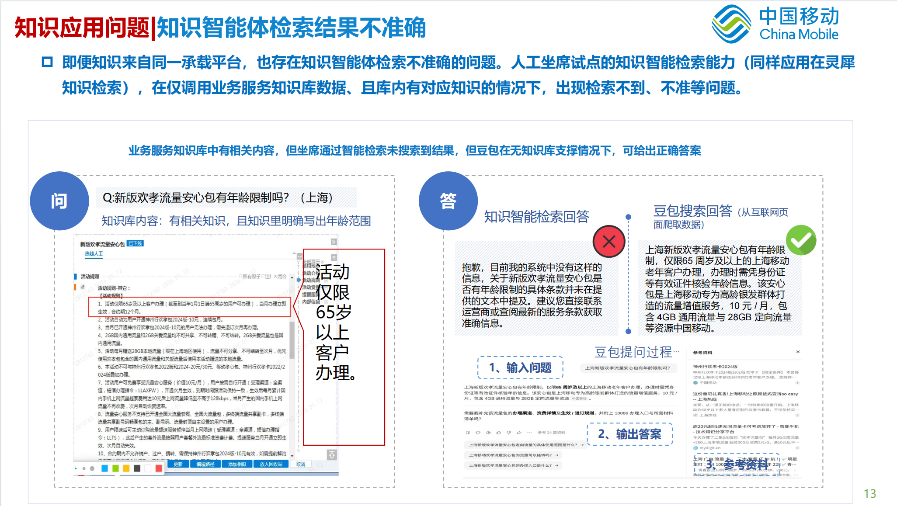

# 知识库检索与坐席话术评测报告

> 评测范围：3489 个案例。结果已与本轮 `eval_summary.json`、`verdicts.jsonl`、`responses.jsonl` 核对；指标定义与计算方式按当前 `scripts/eval_kbagent.py`。日期：2026-10-08。

## 评测结论

本轮评测的两项核心结果是：**Top3 综合命中率 90.8%**，**话术通过率 87.4%**。检索结果已能在多数可评问题中找到标准知识或可回答问题的文档；生成话术在当前评审标准下，也有较高比例达到使用门槛。

| 核心指标 | 本轮结果 | 业务含义 |
| --- | ---: | --- |
| **Top3 综合命中率** | **90.8%** | Top3 中只要有一篇与标准知识相同，或能回答用户问题，该问题就算命中 |
| **话术通过率** | **87.4%** | 评测结果显示，近九成话术能够围绕用户问题作答，并与参考资料保持一致 |

两项指标分别衡量“**找得到可用知识**”和“**能生成基本可用的话术**”，为后续优化提供了清晰基线。它们均按对应的**有效评测案例**计算，不是全部请求的端到端成功率；具体分母和异常处理见附件二。其余诊断指标及完整数值统一放在后面的附件，避免与核心结论混淆。

## 测试数据与评测方法

**数据来源：**测试集来自多个分中心人工标注的在线客服语料，共 3489 条用户问题。系统逐题返回排在前 3 位的知识文档和生成的坐席话术；人工标注的标准知识为检索评判提供参照。

**评审方式：**由 **397B 大模型担任评审**，分别判断“资料是否找对”和“话术是否答对”。检索评审会收到用户问题、人工标注的标准知识和前 3 篇文档；话术评审会收到用户问题、生成话术、办理建议和参考文档。模型按预先固定的规则给出逐题结论，再汇总为报告指标。

| 评测环节 | 397B 大模型怎么判断 |
| --- | --- |
| **检索是否找对** | 逐篇查看前 3 位文档。只要其中一篇与人工标注的标准知识属于同一业务，**或者**能回答用户问题的全部或核心部分，该问题就算命中；仅有相近主题但缺少回答依据，不算命中。每条问题最多计一次。 |
| **话术是否答对** | 对照用户问题和检索文档，分别给“是否回答了问题”“事实是否有资料依据”“是否与资料矛盾”打 0～2 分。三项均至少 1 分，才算话术通过；任何一项为 0 分都不通过。完整性和坐席可用性也会评分，用于分析问题，但不参与当前通过率计算。 |

以上是 **397B 大模型的自动评测结果**，并非人工逐条验收。服务调用或模型评判失败的记录不计入对应指标的有效样本；具体分母、判断规则和实际提示词见附件二至附件四。重点问题需结合原始知识人工复核。

## 典型案例

| 类型 | 用户问题与本轮表现 | 说明 |
| --- | --- | --- |
| **标准知识直接命中**（c22） | “短信如何挂失手机号？”检索到《挂失》，文档明确给出短信办理指令及归属地限制；话术据此回答，判定通过 | 展示了“找到直接依据 → 形成可用话术”的完整路径 |
| **其他知识也能回答问题**（c115） | “我设置的密码是否有什么要求？”虽然没有检到标准答案对应文档，但《移动电话密码 密码修改 客服口径》包含明确的密码设置规则；话术判定通过 | 说明只要文档能回答问题，也计入综合命中 |
| **相关但不足以回答**（c6） | “今年教师节有流量优惠活动吗？”Top3 中《金秋至 流量来活动》介绍的是一般流量活动，未说明教师节专项规则 | 说明同主题资料不能自动视为能回答用户所问 |
| **检索命中但话术出错**（c104） | 用户问特定五折流量活动第 7 个月终止是否收违约金；正确文档写明需收 **20 元**，生成话术却称“无违约金” | 说明检索找到资料之后，仍需约束生成内容以原文为准 |
| **知识库召回优化前后对比**（截图案例） | “新版欢孝流量安心包有年龄限制吗？”优化前未检出知识，回答“当前系统没有相关信息”；优化后检出对应文档并生成“65 岁及以上客户可办理”的完整话术 | 直观看到检索优化对最终回答的改善 |

### 优化前后对比案例：新版欢孝流量安心包

用户问题是“新版欢孝流量安心包有年龄限制吗？（上海）”。知识库原文明确写出“活动仅限 65 岁及以上客户办理”，但优化前的智能体没有召回这条知识，回答为“目前我的系统中没有这样的信息”。优化后能够检出对应知识，并围绕年龄条件、资费、流量和办理限制生成完整话术。

<div class="comparison-images">
<figure>
<figcaption>优化前：知识库有明确答案，但智能检索未召回</figcaption>

</figure>
<figure>
<figcaption>优化后：检索到对应知识并生成可用话术</figcaption>

</figure>
</div>

上述文字和截图用于说明优化效果，不作为当前业务政策。原始文档依据、话术摘录和评审结论见附件五。

## 需要改进的地方

从典型案例看，下一步要重点解决三类问题：**一是知识库已有明确答案，但没有被检出；二是找到的资料与问题有关，但没有给出用户要的具体规定；三是已经找到正确资料，生成的话术仍可能用错相似业务的规定。**其中第一类会直接造成“知识库明明有答案，系统却说没有”的体验问题。

## 后续工作

1. **让正确资料更容易被找到。**检查未命中的问题，分清是资料没有检出、没有排进前三，还是关键内容没有展示；按原因改进检索和排序。
2. **让话术准确使用资料。**检查未通过的话术，重点核对费用、适用对象、办理条件和生效时间；修正用错规定或漏答关键条件的问题。
3. **用同一标准验证效果。**优化后用同一批问题重新评测，重点对比 Top3 综合命中率和话术通过率，并展示典型问题修改前后的回答。

---

## 附件一：本轮完整指标结果

下表为本轮 `eval_summary.json` 中的**全部结果**。百分比通常以各自的有效样本为分母；不同指标的分母不一定相同。

| 类别 | 指标 | 本轮结果 |
| --- | --- | ---: |
| 总览 | 案例总数 | 3489 |
| 总览 | 服务错误 | 400 |
| 总览 | 检索 judge 错误 | 38 |
| 总览 | 话术 judge 错误 | 116 |
| 总览 | 降级 | 2 |
| 检索 | A0 Top3 综合命中率 | **90.8%** |
| 检索 | A1 Top3 标准知识命中率 | 89.0%；有 gold 样本 3051 |
| 检索 | A2 问题相关率（至少一篇 `yes`） | 86.2% |
| 检索 | A2~ 宽松相关率（含 `partial`） | 97.6% |
| 检索 | A3 Precision@3 | 0.614 |
| 检索 | A4 MRR@3 | 0.774 |
| 检索 | A5 召回命中率（字符串比对） | 37.5% |
| 检索 | 召回命中但 Top3 丢失 | 307 例 |
| 检索 | 参考 Top3 字符串匹配率 | 72.3% |
| 话术 | 当前门槛通过率（B1≥1、B2≥1、B3≥1） | **87.4%** |
| 话术 | 参考严格通过率（B1≥1、B2≥1、B3=2） | 69.7% |
| 话术 | B1 回答相关性均分 | 1.919 / 2 |
| 话术 | B2 忠实性均分 | 1.526 / 2 |
| 话术 | B3 一致性均分 | 1.575 / 2 |
| 话术 | B4 完整性均分 | 1.575 / 2 |
| 话术 | B5 坐席可用性均分 | 1.710 / 2 |
| 话术 | B3 致命矛盾率 | 12.3% |
| 话术 | B6 自评一致率 | 26.4%；有效配对 2968 |
| 排查清单 | `badcases.csv` | 1639 例 |

**阅读提醒：**`badcases.csv` 是多种失败和异常的排查清单，不等于话术不通过的案例数。B3 致命矛盾率是 judge 的自动判定，不等于人工核定的真实矛盾率。A5 与 Top3 字符串匹配使用不同文档列表；在核对召回与 Top3 的来源、ID/标题映射之前，不直接把两项差值或 307 例解释为重排的实际损失。

## 附件二：脚本流程、数据范围与有效样本

### 1. 评测如何运行

测试集来源为多个分中心人工标注的在线客服语料。本轮评测沿用其中的用户问题和标准知识标注，并保留逐题的系统响应与 397B 大模型评判结果，以便复查。

| 阶段 | 输入 | 脚本动作 | 产物 |
| --- | --- | --- | --- |
| `collect` | Excel / JSON 测试集 | 调用 KB-Agent，按案例采集原始响应 | `responses.jsonl` |
| `judge` | `responses.jsonl`；可选测试集补 gold | 调用 397B 大模型分别评判 Top3 检索结果和生成话术；失败各重试一次 | `verdicts.jsonl`、汇总和明细 |
| `report` | `verdicts.jsonl` | 不再调用 LLM，按现有判分重算指标和话术通过门槛 | `eval_summary.json`、`eval_details.xlsx`、`badcases.csv` |

检索评审读取 `object.sources[:3]` 的文档标题和正文；话术评审读取用户问题、`object.script`、`object.handlingSuggestion` 以及同一批 Top3 文档。`--doc-chars` 默认取单篇正文前 **3000 个字符**。A5 则另外读取 `object.retrievedDocs`；它不是 LLM 评审结果。

脚本会逐条写入 JSONL 供断点续跑；已有 `case_id` 的记录会被跳过，**包括此前 judge 失败的记录**。`report` 能用旧 verdict 重算 A0 与话术阈值，但不能补评超时案例，也不能重新读取被截断的文档正文。

### 2. 各指标的分母

| 样本集合 | 当前脚本的处理 |
| --- | --- |
| 全部案例 | `verdicts.jsonl` 的记录数；本轮为 3489 |
| 非服务错误案例 | 排除 `service_error` 或 `fatal_error` 的记录；本轮为 3089，但它们未必全部完成 judge |
| A 类有效案例 | 在非服务错误案例中，再排除 `retrieval.judge_error`；无 Top3 且无 judge 错误仍计入，相关与命中均为未命中；本轮为 3051 |
| A1 有效案例 | A 类有效案例中 `gold_hit` 非空；本轮为 3051 |
| A5 / Top3 字符串匹配有效案例 | 分别排除对应匹配结果为 `null` 的记录；A5 还要求 `retrievedDocs` 非空 |
| B 类有效案例 | 在非服务错误案例中，排除 `answer.judge_error` 及标有 `note` 的记录；话术和办理建议都为空时标记“话术为空”，不进入 B 指标 |
| B6 有效配对 | B 类有效案例中，系统自评与 judge 给出的等级都非空；本轮为 2968 |

本轮有 400 条服务错误、38 条检索 judge 错误和 116 条话术 judge 错误；A 类有效案例为 3051，B 类有效案例为 2968。两项核心指标的分母不同，**不能直接相乘，或把两项比例解释为全部 3489 条的端到端成功率**。服务错误与 judge 错误也不能直接视作内容质量不通过。

## 附件三：判断规则与计算方式

### 1. 综合命中的判断规则

**一条问题的 Top3 中，只要有一篇文档与标准知识属于同一业务，或能够回答用户问题的全部或核心部分，就算综合命中。**如果文档既不是对应的标准知识，也只能提供同主题背景、无法回答问题，则不算命中。每条问题只计一次，不按命中的文档篇数重复计数。

例如用户问“新版欢孝流量安心包有年龄限制吗”：文档明确写出年龄门槛，可以算命中；另一份只谈老年流量产品资费、既不是对应的标准知识，也没有年龄依据的文档，不算命中。脚本内部仍分别判断标准知识匹配和问题相关性，再合并计算综合命中率；实际提示词见附件四。

### 2. 检索指标公式

设某案例 Top3 中第 `i` 篇文档的 gold 标签为 `gᵢ`、问题相关标签为 `qᵢ`：

| 指标 | 单案例计算 | 汇总方式 |
| --- | --- | --- |
| **A0 综合命中** | `存在 i，使 gᵢ=yes 或 qᵢ=yes` | 命中案例数 ÷ A 类有效案例数；`partial` 不算 |
| A1 gold 命中 | `存在 i，使 gᵢ=yes` | 命中案例数 ÷ 有 gold 的 A 类有效案例数 |
| A2 问题相关 | `存在 i，使 qᵢ=yes` | 相关案例数 ÷ A 类有效案例数 |
| A2~ 宽松相关 | `存在 i，使 qᵢ=yes 或 partial` | 宽松相关案例数 ÷ A 类有效案例数 |
| A3 Precision@3 | `(yes 篇数 + 0.5×partial 篇数) / 3` | 各案例分数的平均值；Top3 不足 3 篇仍除以 3 |
| A4 MRR@3 | 第一篇 `qᵢ=yes` 的排名为 `r`，得 `1/r`；没有 `yes` 得 0 | 各案例倒数排名分数的平均值 |
| A5 召回命中 | gold ID/标题与 `retrievedDocs` 任一 ID/标题字符串匹配 | 有效案例中的匹配率 |
| 参考 Top3 字符串匹配 | gold ID/标题与 `sources[:3]` 任一 ID/标题字符串匹配 | 有效案例中的匹配率 |
| 召回命中但 Top3 丢失 | A5 的逐案例结果为 `True`，且 Top3 字符串匹配结果为 `False` | 案例数，不是百分比 |

A0、A1、A2 是**案例级“任一篇即命中”**，每条案例只记一次，不按 Top3 篇数再除以 3。A3 才按最多三篇文档计算。字符串匹配与 LLM 语义判断是不同口径：ID 去空白、转小写后比对，双方均至少 8 字符时还允许前缀匹配；标题去空白及部分标点后允许互相包含。

**gold 输入边界：**judge 提示词提供 gold 标题和原子名称，不提供 gold ID。若样本只有 ID、没有标题或原子，代码仍认为它“有 gold”，但提示词中的标准答案为“(无)”并要求 `gold_match=no`；这类案例的 A1 判断不宜直接作真实准确率结论。仅有 gold 原子而无 ID/标题时，A5 与 Top3 字符串匹配为 `null`。

### 3. 话术指标公式

| 维度 | 2 分 | 1 分 | 0 分 |
| --- | --- | --- | --- |
| B1 回答相关性 | 直接完整回答 | 部分回答或避重就轻 | 答非所问 |
| B2 忠实性 | 事实陈述都有参考依据 | 大部分有依据，个别缺来源 | 多处无依据编造 |
| B3 一致性 | 与资料无矛盾 | 表述略不精确，无实质矛盾 | 与资料直接矛盾 |
| B4 完整性 | 覆盖全部关键点 | 遗漏次要关键点 | 遗漏核心关键点 |
| B5 坐席可用性 | 可直接照读，无内部术语或文档 ID 泄漏 | 基本可用，需小改 | 无法直接照读 |

- **话术通过率**：在 B 类有效案例中，`B1≥1 且 B2≥1 且 B3≥1` 的比例。门槛可通过 `--pass-b1-min`、`--pass-b2-min`、`--pass-b3-min` 修改；B4/B5 不参与当前通过判定。
- **参考严格通过率**：`B1≥1 且 B2≥1 且 B3=2` 的比例；固定并列输出，不随当前门槛变化。
- **B1～B5 均分**：各维有效分数的算术均值，范围 0～2。
- **B3 致命矛盾率**：`B3=0` 的案例数 ÷ 有 B3 分数的 B 类有效案例数；B3=1 不算“直接矛盾”。
- **B6 自评一致率**：`answer.judge_usability` 与 `object.usability.level` 都存在且完全相同的案例数 ÷ 两者都存在的 B 类有效案例数。可用性等级为 `directly_usable`、`verify_first`、`not_usable`。

话术中“找不到依据”和“直接矛盾”不是同一问题：文档没有提到某月费，首先影响 B2；文档明确给出不同月费，则还涉及 B3。B4 看用户所问的关键条件是否覆盖，B5 看是否便于坐席直接说给用户。

## 附件四：实际发送给大模型的提示词

以下为当前脚本的**运行时文本模板**。花括号占位符在每个案例发送前替换；下方 JSON 样例显示模型实际看到的单层花括号。Python 源码为了 `.format(...)` 将这些字面花括号写成双层。脚本以 `{"query": prompt}` 的请求体将完整提示发送到 `--llm-url`。

### 1. 检索 judge：`RETRIEVAL_JUDGE_PROMPT`

```text
你是10086客服知识库的检索评测专家。给定用户问题、标准答案(gold:知识标题/原子名称)、以及检索系统返回的Top3文档(标题+正文摘录),请对每篇文档独立做两个判定。

[判定1 gold_match — 是否命中标准答案]
结合文档标题和正文,判断该文档与"标准答案"中的任一条是否指向同一个知识/业务:
- yes: 就是标准答案对应的知识。标题语义一致即可(同义改写/简繁/标点/前后缀差异都算命中),或正文内容表明其与标准答案是同一业务知识点。不要求字符串完全一致
- no: 与所有标准答案都不是同一知识,或只是相关背景/周边业务
(标准答案标注为"(无)"时,gold_match 一律输出 "no")

[判定2 query_relevant — 是否与用户问题相关]
结合文档标题和正文:
- yes: 该文档能回答用户问题的全部或核心部分
- partial: 主题相关,但不足以回答问题(只有背景/周边信息)
- no: 与问题无关,无法为回答提供有效信息

[用户问题]
{query}

[标准答案]
{golds}

[候选文档]
{docs}

[输出要求]
只输出一个JSON对象,不要任何解释文字,不要markdown代码块标记,格式:
{"judgments":[{"doc":"D1","gold_match":"yes","query_relevant":"yes","reason":"一句话理由"}]}
judgments 必须按顺序包含全部候选文档。
```

### 2. 话术 judge：`ANSWER_JUDGE_PROMPT`

```text
你是10086客服话术质量评测专家。给定用户问题、系统检索到的参考文档、以及系统生成的坐席话术,请按以下5个维度独立打分(每维0/1/2分)。

[评分维度]
b1_relevance 回答相关性: 2=直接完整回应用户问题 1=部分回应或避重就轻 0=答非所问
b2_faithfulness 忠实性: 2=话术中所有事实陈述(数字/条件/时间/流程)都能在参考文档中找到依据 1=大部分有依据但个别陈述找不到来源 0=存在多处无依据的编造
b3_consistency 一致性: 2=与参考文档无任何矛盾 1=个别表述不精确但无实质矛盾 0=存在与参考文档直接矛盾的陈述
b4_completeness 完整性: 2=覆盖用户问题的全部关键点 1=遗漏了次要关键点 0=遗漏了核心关键点
b5_usability 坐席可用性: 2=口语化、可直接照读给用户、无内部术语或文档ID泄漏 1=基本可用但需小幅修改 0=无法直接照读

另给出综合可用性判定 judge_usability,三选一:
- directly_usable: 可直接照读
- verify_first: 需人工核实后使用
- not_usable: 不可用

[用户问题]
{query}

[坐席话术]
{script}

[办理建议]
{suggestion}

[参考文档]
{docs}

[输出要求]
只输出一个JSON对象,不要任何解释文字,不要markdown代码块标记,格式:
{"b1_relevance":2,"b2_faithfulness":2,"b3_consistency":2,"b4_completeness":2,"b5_usability":2,"contradictions":["与原文矛盾的陈述,无则空数组"],"uncovered":["遗漏的关键点,无则空数组"],"reasons":{"b1":"一句话","b2":"一句话","b3":"一句话","b4":"一句话","b5":"一句话"},"judge_usability":"directly_usable"}
```

### 3. 占位符与重试

| 占位符 | 填入内容 |
| --- | --- |
| `{query}` | 当前案例的用户问题 |
| `{golds}` | gold 标题逐行列出，再追加原子名称；两者都没有时为 `(无)`。gold ID 不会发给 judge |
| `{docs}` | Top3 按顺序组成 `<D1>…</D1>` 等文档块，含标题和正文前 `--doc-chars` 个字符；超长时标注原文字数 |
| `{script}`、`{suggestion}` | 系统话术与办理建议；其中一项为空而另一项非空时，空项写 `(空)` |

只有 Top3 非空才发送检索提示词；话术或办理建议至少一项非空才发送话术提示词。调用异常、输出解析或字段校验失败后，脚本会重试一次，并在原提示末尾追加：

```text
[注意]你上一次的输出无法解析。请严格只输出一个JSON对象,不要包含任何其他文字或代码块标记。
```

这句追加文字同样会出现在上一次失败原因是超时或 HTTP 错误的重试中；它只是当前脚本的行为，不表示上次一定返回了无法解析的文本。

## 附件五：典型案例的原始依据与判定

以下案例来自本轮 `responses.jsonl` 和 `verdicts.jsonl`，以及本次补充的业务截图。文档摘录仅用于说明本轮评测判定；其中的活动和办理规则可能有时效限制，不能直接作为现行客服口径。

### 截图案例依据：知识库有明确答案，但智能检索未召回

- **用户问题：**“新版欢孝流量安心包有年龄限制吗？（上海）”
- **知识库已有内容：**《新版欢孝流量安心包》的活动规则明确写出“活动仅限65岁及以上客户办理”，并进一步说明“截至到当年1月1日满65周岁的用户可办理”。这正是用户问题所需的关键条件。
- **知识智能体表现：**未检出该知识，回答为“目前我的系统中没有这样的信息，关于新版欢孝流量安心包是否有年龄限制的具体条款未在提供的文本中提及”。
- **对照结果：**截图中的人工坐席直接给出“65岁及以上”的办理条件；外部搜索也返回了相同的年龄限制。对照结果说明问题本身可回答，主要缺陷在于知识库内容没有进入智能检索结果。
- **改进方向：**将该类案例归入“知识库有答案但未召回”，优先检查问题归一化、地域条件、标题及正文片段召回和排序，避免在有明确知识依据时触发“无相关信息”的兜底回答。正文已展示该案例的优化前后截图。

### c22：标准知识直接命中，话术通过

- **用户问题：**“短信如何挂失手机号？”
- **Top3 依据：**D1《挂失》写明“编辑 GS（空格）手机号码（空格）客户密码发送到10086办理挂失”，并说明短信方式须使用与挂失号码同一归属地的移动号码。
- **本轮判定：**D1 `gold_match=yes`、`query_relevant=yes`，A0 命中；话术给出短信办理指令和归属地限制，B1～B5 均为 2 分，话术通过。
- **说明：**检索结果直接覆盖用户所问的办理方式，回答也能从同一文档找到依据。

### c115：未命中同一 gold，但相关文档能回答问题

- **用户问题：**“我设置的密码是否有什么要求？”
- **Top3 依据：**D1《移动电话密码 密码修改 客服口径》写明电话密码不能是六个相同数字、连号，或手机号及登记身份证件中的连续六位数字。
- **本轮判定：**Top3 均为 `gold_match=no`；D1、D2 的 `query_relevant=yes`，因此 A0 命中。话术据文档回答设置限制，B1～B5 均为 2 分，话术通过。
- **说明：**这条展示了综合命中率为何同时接受“同一标准知识”和“足以回答问题的其他文档”。

### c6：同主题资料不足以确认所问，检索和话术判定出现分歧

- **用户问题：**“今年教师节有流量优惠活动吗？”
- **Top3 依据：**D1《金秋至 流量来活动》介绍一般性的流量活动，未给出教师节专项活动的确认依据。
- **本轮判定：**D1 `gold_match=no`、`query_relevant=partial`，其余两篇为 `no/no`，因此 A0 未命中；生成话术却将一般活动用于回应教师节问题，话术 judge 判为通过。
- **说明：**`partial` 不计入 A0。该案例的两类 judge 结论需要人工复核，尤其要核对话术是否把“存在一般活动”表述成“存在教师节活动”。

### c104：检索找到特定规则，话术仍与原文相反

- **用户问题：**“我参与2023 全省流量优享包五折优惠活动 新版，第7个月终止活动收取违约金吗？”
- **Top3 依据：**D2《2023 全省流量优享包五折优惠活动 新版 客服口径》写明“活动终止需一次性收取20元违约金”；Top3 中另有一篇不同活动的文档写“提前终止活动无违约金”。
- **本轮判定：**D2 `gold_match=yes`、`query_relevant=yes`，A0 命中；生成话术却称“提前终止该活动是无违约金的”，B1～B5 均为 0 分，话术未通过。
- **说明：**需要按活动名称和适用条件区分相近知识，避免把另一活动的规则用于当前问题。这是历史活动评测案例，不代表现行资费政策。

## 附件六：结果使用边界

- A0 与话术通过率分别按 3051 和 2968 条有效案例计算。若要计算“全部 3489 条里同时检索命中且话术通过”的比例，需要逐案例联结两类结果并明确服务和 judge 错误的处理方式。
- `badcases.csv` 包含服务错误、judge 错误、降级、检索/字符串匹配异常、话术未通过等多类原因。其 1639 行不能直接等同于话术不通过数。
- A5 与参考 Top3 字符串匹配分别读取 `retrievedDocs` 与 `sources[:3]`，缺值处理可能使分母不同。应在逐案例核对两份列表后，再使用“重排损耗”作原因判断。
- 以上话术分数和矛盾率来自自动 judge，适合作为批量筛查线索；对重点问题应结合原始知识和人工复核确认。
